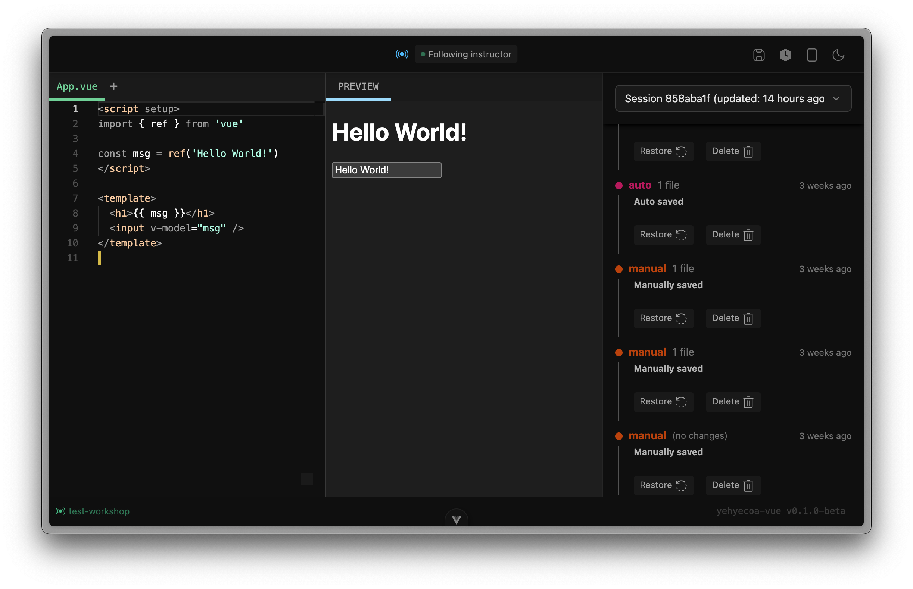
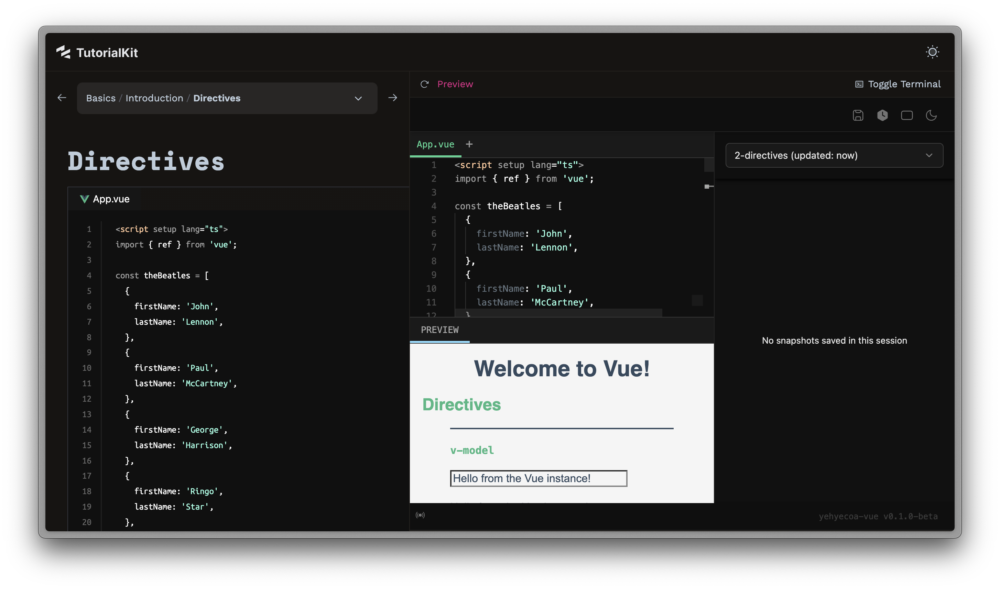

# yehyecoa-vue

> **[yeh-yeh-CO-ah](https://nahuatl.wired-humanities.org/content/yeyecoa)** in Nahuatl means to try something; to try or experiment with something; to rehearse;

This is our own spin on the [Vue Playground](https://github.com/vuejs/core/blob/main/packages-private/sfc-playground/README.md). Originally intended to be used within a [TutorialKit](https://tutorialkit.dev/) (_tk_ in this readme to save some keystrokes) preview window.

Most notably, it doesn't allow for switching Vue versions nor it displays the compiled code. Since this will be focused (at least at first) on the basic concepts, we don't want all of that.



## Usage

### As part of [amoxtli-vue](https://github.com/ackzell/amoxtli-vue)

This is the playground that will load into a preview pane in the `amoxtli-vue` project.
It reads the different [code files in the lessons](https://tutorialkit.dev/guides/creating-content/#a-lesson-code) provided from that repo and loads them into the monaco editor to interact with them.



#### Installing it in amoxtli-vue

An npm task is available for when you want to see your changes embedded into the tk project:

```bash
# build and install on tk project
npm bi
```

This will first build the project and then copy the required contents from the `.output` folder into the `amoxtli-vue/src/templates/yehyecoa/` folder.

### Standalone

> [!Note]
> This Nuxt project has some server side code to read the contents of the root (where the project is being run / deployed) and looks for a `lessonFile.vue` to be the contents of the playground on load. It also has logic to determine that there were changes on the file and thus will live-update them in the editor.

<todo: list the files that contain such logic here>

# Nuxt's Readme:

# Nuxt Minimal Starter

Look at the [Nuxt documentation](https://nuxt.com/docs/getting-started/introduction) to learn more.

## Setup

Make sure to install dependencies:

```bash
# npm
npm install

# pnpm
pnpm install

# yarn
yarn install

# bun
bun install
```

## Development Server

Start the development server on `http://localhost:3000`:

```bash
# npm
npm run dev

# pnpm
pnpm dev

# yarn
yarn dev

# bun
bun run dev
```

## Production

Build the application for production:

```bash
# npm
npm run build

# pnpm
pnpm build

# yarn
yarn build

# bun
bun run build
```

Locally preview production build:

```bash
# npm
npm run preview

# pnpm
pnpm preview

# yarn
yarn preview

# bun
bun run preview
```

Check out the [deployment documentation](https://nuxt.com/docs/getting-started/deployment) for more information.
